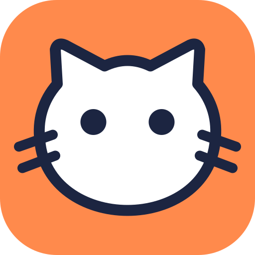

  

<h1 align="center">Clawde</h1>

  A small macOS menu bar app that shows how much of your <b>Claude</b> and <b>Google Antigravity</b> usage limits you've used, without opening either app.

  <a href="https://github.com/DYitaoW/clawde/releases/latest"><b>Download for Mac</b></a> · Apple Silicon · macOS 12+

<!-- Screenshot: add docs/screenshot.png and uncomment

-->

## Features

- **Menu bar at a glance**: session (5-hour) usage percentage and ring for each service, with an optional inner ring for weekly usage.
- **Popover details**: session and weekly usage, time until each limit resets, and a pace indicator (% per hour).
- **Alerts**: optional desktop notification when usage passes a threshold you choose.
- **System stats**: optional CPU and memory usage in the popover header.
- **Automatic updates**: new versions download in the background and install on restart.
- Works in light and dark menu bars.

## Requirements

- macOS 12 (Monterey) or later
- **Apple Silicon Mac (M1 or newer).** Intel Macs are not supported.

## Install

1. Download the latest `Clawde-x.y.z-arm64.dmg` from [Releases](https://github.com/DYitaoW/clawde/releases/latest).
2. Open the DMG and drag **Clawde** into **Applications**.
3. Clawde appears in the menu bar (there's no Dock icon). Click it and sign in to Claude and/or Antigravity.

## Updating

Clawde updates itself. It checks GitHub twice a day and downloads new versions in the background. When an update is ready, a **Restart to update** button appears at the bottom of the popover. Click it, or just keep going: the update installs the next time Clawde quits. You can also check manually in **Settings → About**.

## Privacy

- Everything stays on your Mac. Clawde talks only to claude.ai, Google (for Antigravity sign-in and quota), the local Antigravity app if it's running, and GitHub (for the update check).
- Saved sign-in sessions are encrypted with the macOS Keychain.
- No analytics or tracking.

## Disclaimer

Clawde is an unofficial, independent project. It is **not affiliated with, endorsed by, or sponsored by Anthropic or Google**. "Claude" is a trademark of Anthropic; "Antigravity" and "Gemini" are trademarks of Google.

Clawde reads usage data the same way the official websites and apps do. These are not public APIs: they can change or stop working at any time, which may break Clawde until it's updated. Use at your own risk.

## License

[MIT](LICENSE)
